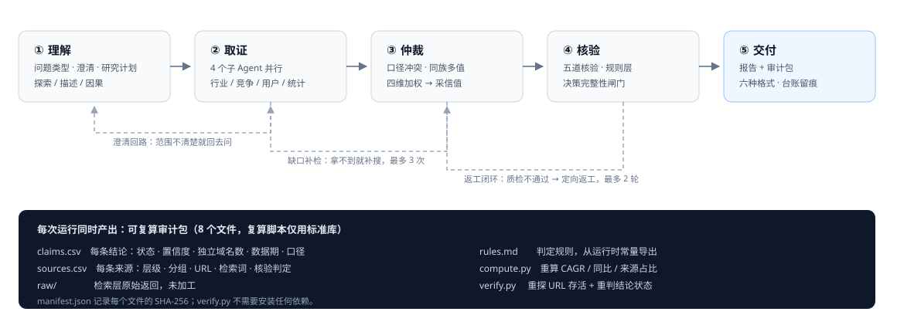
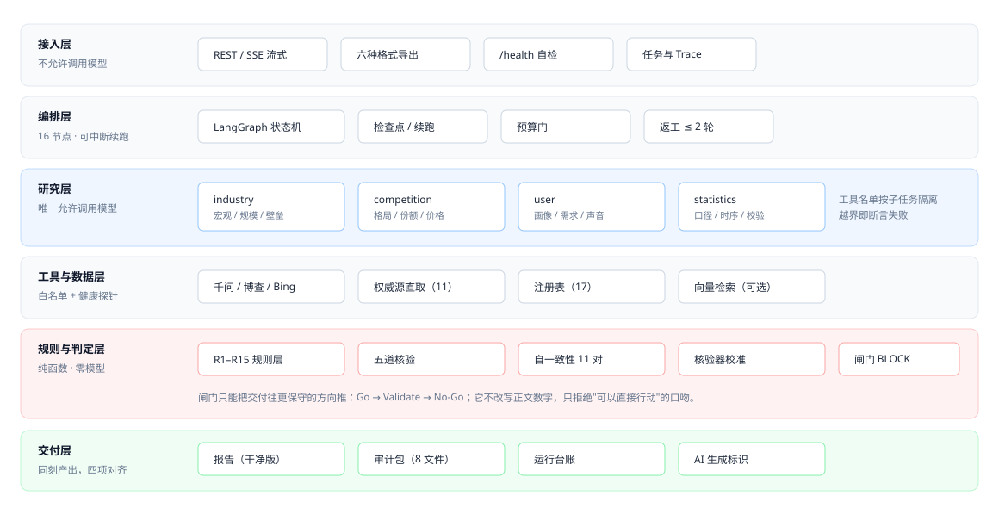
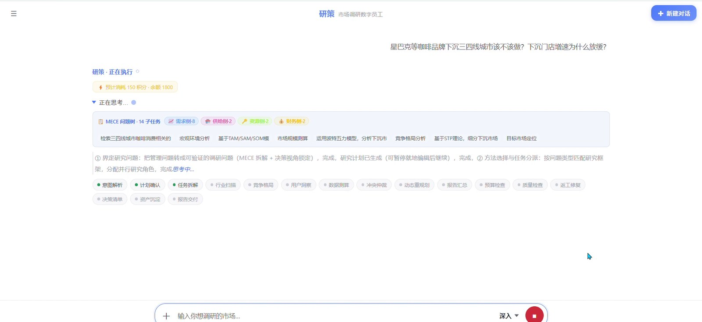
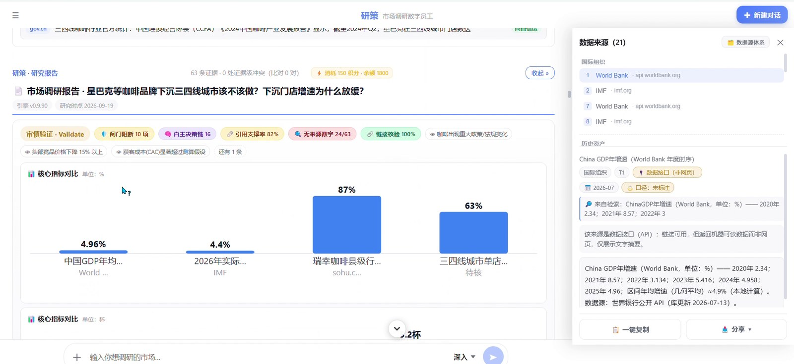

# 研策 · Yancec

**可审计的市场调研智能体** — 把一句模糊的商业问题，变成一份「每个数字都能被第三方重算一遍」的决策研究报告。

<p>
  
  
  
  
  
  
</p>

> **English summary**
> Yancec is an auditable market-research agent built on a 16-node LangGraph state machine.
> Instead of promising better answers, it makes every answer checkable: claims carry evidence
> and confidence, numeric conflicts are detected by a deterministic rule layer, and each run
> ships an 8-file audit bundle whose `verify.py` / `compute.py` recompute the report with the
> Python standard library alone. The project was built for the 2026 AI Agent competition
> (AI Hangzhou) and is published here as an engineering portfolio piece.

---

## 30 秒看懂

| | |
|---|---|
| **是什么** | 一个会做行业研究的智能体：澄清问题 → 拆 MECE 问题树 → 多子 Agent 并行取证 → 冲突仲裁 → 决策 SOP → 交付报告 + 可复算审计包 |
| **不是什么** | 不是"更会写"的 Deep Research。它不靠文风取胜，靠**每一句话都能被追问** |
| **给谁用** | 要做不可逆决策、又请不起咨询团队的中小团队：加盟评估、出海选品、立项 market sizing |
| **差异点** | 交付物自带审计链：证据分级、来源资格校验、数字冲突扫描、决策完整性闸门、核验器自校准 |
| **当前状态** | 可本地跑通的研究原型（v0.9.90）。无多租户、无 SaaS 部署；已知边界写在 [§8](#8-已知边界) |

<p align="center">
  
</p>

---

## 1. 为什么做这件事

大模型做研究，问题从来不是"写不出来"，而是**写得太顺**：一个没有出处的数字，被写进执行摘要；两个互相矛盾的统计口径，被并排放在两页里；一句"行业数据显示"，被当成事实。

这类错误有一个共同点——**它们都不是模型算错的，而是模型"补"出来的**。所以这个项目的核心不是把报告写得更漂亮，而是把"补"的空间压掉：

- 能用代码算的，不交给规则判；
- 能用规则判的，不交给模型；
- 模型必须参与的地方，留下可复核的轨迹；
- 实在无法确认的，**明写"证据不足"，而不是给一个像样的数**。

这条取舍贯穿整个系统，也是它和通用 Deep Research 产品最不一样的地方。

---

## 2. 它怎么工作

<p align="center">
  
</p>

**一条主线**：`router → human_confirm → route_skill → [industry | competition | user | statistics] → check_conflict → replan → summarize → budget_check → quality_check → rework_fix → decision_sop → asset_sink → deliver`

16 个 LangGraph 节点，其中 4 个研究子 Agent 并行取证；`rework_fix` 最多两轮定向返工；状态可 checkpoint，中断可续跑。

**三条引擎链**：

1. **证据链** — 每条结论挂来源、层级（L1 官方 / L2 法定披露 / L3 行业机构 / L4 媒体 / L5 用户声音）、数据期与口径；
2. **仲裁链** — 同一指标出现多值时，四维加权（来源层级 / 独立性 / 时效 / 一致性）后给出采信值，冲突不隐藏，进《口径对照》；
3. **决策链** — 每个判断记录"谁在决定"：模型、规则、混合还是人；决策链条数与正文逐条对账。

**一个闭环**：`asset_sink` 把本次调研沉淀成行业证据卡，下一次同行业调研可以复用；复购看板的四个指标各挂自己的分母，不混算。

---

## 3. 五个可以被现场验证的机制

这一节只写"你可以当场打开、当场跑、当场对账"的东西。

### 3.1 可复算审计包（8 个文件，不依赖本项目）

每次运行产出 `audit_bundle/`：

```
README.md       三步复算指引：哪一步验证什么
manifest.json   包元数据 + 每个文件的 SHA-256（防中途篡改）
rules.md        本次运行的判定规则，从运行时常量直接导出
claims.csv      每条结论：置信度 · 状态 · 独立域名数 · 来源 · 数据期 · 口径
sources.csv     每条来源：层级 · 分组 · URL · 检索词 · 核验判定
raw/            检索层原始返回，未加工
compute.py      仅标准库：从 raw 重算 CAGR / 同比 / 来源结构占比
verify.py       仅标准库：重探每个引用 URL 存活，并重判结论状态
```

`python verify.py` 不需要装任何依赖。它做的不是"相信报告"，而是**把报告里的算术再做一遍**。

### 3.2 决策完整性闸门（BLOCK，而不是提示）

报告交付前有一道闸门：高风险发现如果落在**决策区**（执行摘要、决策判定、行动建议、成本测算），交付状态被强制降为 `Validate`，并在报告顶部打印阻断清单。

关键设计：**闸门只降不升**。它可以否决一次交付，但不能把一次本该被否决的交付"洗白"。判定结果、命中位置、未阻断原因全部留痕。

### 3.3 规则层 R1–R15（确定性，零模型）

不做"让模型再检查一遍"，而是把已经踩过的坑写成规则：

| 规则 | 抓什么 |
|---|---|
| R1 | 同一关键指标在报告不同位置取值跨度过大 |
| R2 | 把未来年份当作已发生事实引用 |
| R3 | 财务缩写/术语全报告未定义 |
| R4 | "行业数据显示"式匿名来源却带具体数值 |
| R5 | 正文算术错误（如 32 元写成"日均收入的 97%"） |
| R6 | 伪量化（0–10 打分但无方法学/样本） |
| R7 | 来源资格错配（政府/宏观来源背书企业微观数据） |
| R8 | 正文声称"修正了引擎输出"，或当众在两个数之间择一 |
| R9–R15 | 量纲混用、同族多值、决策阈值低于自算盈亏平衡线等 |

规则层是纯函数：同样的输入，永远同样的输出。**它不保证报告对，它保证"同一类错不会第二次悄悄通过"。**

### 3.4 核验器自校准（把"我们的核验很准"变成可证伪的数字）

`calibrate.py` 用 8 条正例 + 8 条反例，测核验器会不会把"不支持"判成"支持"：

- 严格假阳性率（反例被判 support）：**0.0%**
- 真阳性率：**100%**
- 但 8 条反例只能支撑"单侧 95% 上界 31.2%"——所以报告里报的是**区间**，不是"0 误判"。

这是这个项目里最反直觉、也最重要的一条纪律：**样本量不够时，不许把点估计当结论。**

### 3.5 离线自测（176 个断言，不依赖 API Key）

```bash
cd backend && python selftest.py
```

176 个断言覆盖路由、MECE、来源白名单、置信度、规则层、闸门、审计包、导出、端到端状态机。运行不需要任何 API Key；缺第三方依赖、缺 `.env` 或内部材料的项会自动标记 **SKIP**，不混进失败。少数权威源探针会真实访问公开站点，无网络时相关项转 SKIP。

> **基线（2026-11-09 实测，Windows / Python 3.10，干净 clone、无 `.env`）：166 通过 / 10 跳过 / 0 失败。** 装齐依赖后跳过项会真正执行，通过数上升；环境不同基线会变，所以这里报的是「有一次真实运行作证」的那组数，不是承诺值。

---

## 4. 实测数据（可复核）

> 测量时点：2026-09-19。数字由 `scripts/repo_stats.py` 从本仓库重新计算，**不是手写的**。

| 项 | 值 |
|---|---|
| 引擎版本 | `v0.9.90`（唯一出处 `backend/core/version.py`） |
| 状态机 | 16 个 LangGraph 节点 / 4 个并行研究子 Agent |
| 后端 | 81 个 `.py` / 47,509 行（含测试与工具脚本） |
| `core/` 模块 | 65 个（证据、规则、闸门、审计、校准各自独立） |
| 前端 | React 19 + Vite，`App.jsx` 4,882 行 |
| 离线断言 | 176 个（`backend/selftest.py`，缺依赖项自动 SKIP） |
| 数据源注册表 | 17 条（16 已接入 / 1 规划中，状态由代码自报） |
| 规则层 | R1–R15 |
| 审计包 | 8 个文件，复算脚本仅用标准库 |

<p align="center">
  
  
</p>
<p align="center"><sub>界面实拍（2026-09-19，共 8 张，见 <a href="docs/UI.md">docs/UI.md</a>）</sub></p>

---

## 5. 快速开始

**前置**：Python 3.11+、Node.js 20+。没有 API Key 也能启动，系统进入离线演示模式并在报告头部说明降级原因。

```bash
git clone https://github.com/<your-name>/yancec.git
cd yancec

# 1) 后端
python -m venv .venv
source .venv/bin/activate          # Windows: .venv\Scripts\activate
pip install -e ".[dev]"
cp .env.example .env               # 填入自己的 Key（可留空）
cd backend && uvicorn app:app --host 127.0.0.1 --port 8000

# 2) 前端（另开一个终端）
cd frontend
npm install
npm run dev                        # http://127.0.0.1:5173
```

**先跑自测，再跑产品**：

```bash
cd backend
python selftest.py                 # 176 个离线断言
python mrbench.py                  # 8 题路由器/规划层回归
```

**不启动服务，直接看审计包能力**：

```bash
python -c "from core.audit_bundle import *"   # 见 docs/AUDIT_PIPELINE.md
```

---

## 6. 目录结构

```
backend/
├── app.py                  FastAPI 服务 + SSE 流式执行
├── graph.py                LangGraph 状态机（16 节点，核心编排）
├── agents/
│   ├── router.py           任务理解 / 研究计划 / 问题类型分流
│   ├── researchers.py      4 个子 Agent + 确定性测算
│   ├── quality.py          质检（规则层 + 模型复核）
│   └── decision.py         决策判定 + 14 天验证任务
├── core/                   65 个模块
│   ├── rule_lint.py        R1–R15 规则层
│   ├── integrity_gate.py   决策完整性闸门
│   ├── audit_bundle.py     可复算审计包
│   ├── evidence_matrix.py  双源配对矩阵
│   ├── source_quality.py   L1–L5 分级与来源资格
│   ├── calibration.py      核验器校准
│   └── …
├── mcp/search.py           多源检索适配层（博查 / Bing / 千问 / 直取）
├── skills/                 方法论包（market-entry / pet-economy）
├── tests/                  pytest 用例
├── selftest.py             176 个离线断言
└── mrbench.py              MR-Bench 轻量回归
frontend/                   React 19 + Vite 工作台
docs/                       架构、机制、评测、运维、ADR
scripts/                    仓库统计与密钥扫描
```

---

## 7. 设计取舍

**为什么把计算"下沉"到代码，而不是让模型算。**
模型做算术不是不会，而是不稳定：同一道题两次运行可能给出两个答案。所以 TAM/SAM/SOM、CAGR、盈亏平衡全部由确定性模块计算，模型只负责解释。代价是灵活性，换来的是"同一个输入，永远同一个数"。

**为什么闸门只降不升。**
如果闸门既能降级又能升级，它就会变成一个新的"洗白通道"。只允许往更保守的方向走，它才是一道闸门，而不是一个装饰。

**为什么明写"证据不足"，而不是补一个像样的数。**
研究的价值不在于"看起来很完整"，而在于决策者知道哪一块地基是软的。Unknown 是一种交付物，不是失败。

**为什么核验器要自校准。**
"我们的核验很准"是一句无法证伪的话。把它变成 FPR/TPR 与置信区间，才能被外部审计，也才能在下一次改提示词时知道有没有变差。

**为什么审计包只用标准库。**
如果复算需要先装 20 个依赖，它就不是复算，是"请相信我们的环境"。

---

## 8. 已知边界

写在这里的，都是真的没做好、或者明确不做的。**面试官可以直接问这些。**

| 边界 | 现状 | 计划 |
|---|---|---|
| 前端是单文件实现 | `App.jsx` 4,882 行，可运行但未组件化 | 按「四区 + 八抽屉」拆分为 `components/`，见 [ROADMAP](docs/ROADMAP.md) |
| 无多租户 / 无鉴权 | 本地单用户原型，任务存内存 | 生产化时引入任务队列 + 持久化 + OIDC |
| 检索依赖第三方通道 | 博查/Bing 的可用性直接决定取证质量 | 增加通道健康探针与自动切换；已实现直取源 11 条 |
| 数据源覆盖不均 | 消费/制造较强，医疗、跨境较弱 | 按场景包逐个补源，注册表状态由代码自报 |
| 无真实付费用户 | 只有真实运行记录，没有真实客户 | 不做"付费意愿"叙事，先做 6–10 家访谈 |
| 模型参数非确定 | 同一版本两次运行可能选不同 L5 假设 | 已引入 `assumption_set` 内容哈希，同哈希才可横比 |
| 评测集规模有限 | MR-Bench 8 题轻量回归，非公开榜单 | 扩到 4 题型 × 5 领域，补齐标注 |

---

## 9. 评测与基线

**MR-Bench（轻量版）**：8 个真实行业问题，覆盖 exploratory / descriptive / causal 三类；对每题做确定性回归——问题类型路由、MECE 树、因果假设是否成立。它测的是"规划层有没有退化"，不是"文笔好不好"。

**核验器校准**：8 正例 + 8 反例，输出严格 FPR、宽松 FPR、TPR 与单侧 95% 上界。每次修改 `core/entailment.py` 的判定提示词都应重跑。

**自测**：`backend/selftest.py` 176 个断言，覆盖 20+ 个模块的边界条件。它比单元测试更"重"，因为它测的是**契约**：同一个数字在报告、审计包、前端三处必须一致。

---

## 10. 赛事背景

本项目是 **2026 AI 模型智能体创新大赛（AI 杭州 · 码动未来）** 的参赛作品，赛道为「AI + 超级智能体」。

参赛过程中完成的工作包括：16 节点状态机的工程落地、五道核验与闸门机制、可复算审计包、核验器校准、8 个真实行业问题的回归评测，以及 3 分 18 秒的产品演示。代码、文档与评测脚本均在本仓库中，可独立复跑。

> 说明：仓库只描述项目本身，不把赛事结果当作项目质量的论据。所有能力以代码与可复跑结果为准。

---

## 11. 许可与引用

- 代码：[MIT](LICENSE)
- 文档与图片：[CC BY 4.0](https://creativecommons.org/licenses/by/4.0/)
- 引用：

```bibtex
@misc{yancec2026,
  title  = {Yancec: an auditable market-research agent},
  author = {Yancec},
  year   = {2026},
  url    = {https://github.com/<your-name>/yancec}
}
```

**安全**：仓库不含任何密钥。若你在历史版本或分发包里见过 `.env`，请立即轮换对应 Key，参见 [SECURITY.md](SECURITY.md)。
