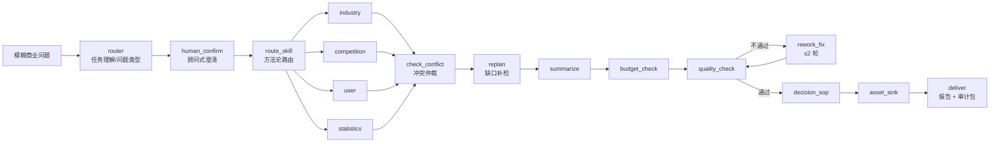

# 架构

> 本文回答三个问题：系统由哪些层组成、一次运行如何流转、在哪里扩展。
> 机制细节见 [AUDIT_PIPELINE.md](AUDIT_PIPELINE.md)，评测见 [EVALUATION.md](EVALUATION.md)。

## 1. 总览

系统是「一条主线 + 三条引擎链 + 一个闭环」。主线是 LangGraph 状态机，引擎链分别是证据、仲裁、决策，闭环是资产沉淀与复用。



## 2. 分层

| 层 | 位置 | 职责 | 允许调用模型 |
|---|---|---|---|
| 接入层 | `app.py` | REST / SSE / 导出 / 健康检查 | 否 |
| 编排层 | `graph.py` | 状态机、检查点、并行子任务、预算 | 否 |
| 研究层 | `agents/researchers.py` | 四个维度的取证与结构化 | 是 |
| 工具层 | `mcp/search.py` | 检索通道、直取源、限流与降级 | 否 |
| 规则层 | `core/rule_lint.py` 等 | 确定性检查，纯函数 | 否 |
| 判定层 | `core/integrity_gate.py` | 汇总各层发现，决定 PASS/WARN/BLOCK | 否 |
| 交付层 | `core/report_*` `core/audit_bundle.py` | 多格式导出、审计包 | 否 |

「允许调用模型」这一列是硬约束：**编排层与规则层不允许出现模型调用**。这样任何一次判定的差异都只能来自输入，不能来自采样。

## 3. 16 个节点

| # | 节点 | 类型 | 做什么 | 失败时 |
|---|---|---|---|---|
| 1 | `router` | 模型 + 规则 | 任务理解、问题类型（探索/描述/因果）、研究计划 | 降级为规则模板，并在报告注明 |
| 2 | `human_confirm` | 人 | 澄清问题、确认研究范围 | 可跳过（自动确认） |
| 3 | `route_skill` | 规则 | 选择方法论包（market-entry 等） | 回退通用框架 |
| 4–7 | `industry` `competition` `user` `statistics` | 模型 + 工具 | 四维并行取证 | 单维度空手而归是合法结果 |
| 8 | `check_conflict` | 规则 + 模型 | 口径冲突、同族多值、量纲检查 | 记录冲突并降置信度 |
| 9 | `replan` | 规则 | 缺口驱动的追加检索（≤3 次） | 停止并披露缺口 |
| 10 | `summarize` | 模型 | 结构化汇总，不新增事实 | 保留原始结构化数据 |
| 11 | `budget_check` | 规则 | 积分/预算门，超限停止 | 返回已得结果 + 停止原因 |
| 12 | `quality_check` | 规则 + 模型 | 质检，产出 fatal/major 问题 | 进入返工 |
| 13 | `rework_fix` | 模型 | 定向返工（≤2 轮） | 第二轮仍失败则带病披露 |
| 14 | `decision_sop` | 规则 + 模型 | 决策判定、Go/No-Go、14 天验证 | 输出"证据不足" |
| 15 | `asset_sink` | 规则 | 行业证据卡沉淀 | 跳过，不影响交付 |
| 16 | `deliver` | 规则 | 报告、审计包、多格式导出 | 交付降级并留痕 |

## 4. 一次运行的状态

`core/state.py` 定义的状态对象是唯一事实源。关键字段：

```python
question            # 原始问题
problem_type        # exploratory / descriptive / causal
plan                # 子任务清单（可编辑）
evidence            # 证据条目：内容/来源/层级/数据期/口径/URL
claims              # 结论：状态/置信度/独立域名数/支撑证据
conflicts           # 冲突组：指标/取值/来源/采信值
decision_records    # 决策链：谁在决定（模型/规则/混合/人）
gate                # 闸门结论：level/findings/blockers
assumption_set      # 测算输入的规范化哈希
report_final        # 干净版报告（对外交付）
```

检查点由 LangGraph 持久化，中断后可续跑；同一 `thread_id` 不会重复计费。

## 5. 并行与隔离

四个研究子 Agent 并行执行，但**工具名单按子任务隔离**：`industry` 看不到 `user` 的工具，反之亦然。这条约束由断言守着（`selftest.py` 第 104 节），越界即变红。

并行带来的一个设计问题是"合并什么"。这里的答案是：**合并发生在资料池，不发生在结论上**。子 Agent 返回的是证据条目，冲突与结论由 `check_conflict` 统一处理，避免四个子 Agent 各自下一个互斥的判断。

## 6. 失败语义

系统区分三种"没做成"，并且都要求显式表达：

| 类型 | 含义 | 表达方式 |
|---|---|---|
| 空返回 | 检索通道正常，但没有结果 | 记 `empty`，不计入"跳过" |
| 计划跳过 | 该源族本轮不需要 | 记 `planned_skip`，计数 |
| 降级 | 通道不可用，换了下一条 | 记 `degraded`，报告头部说明 |

这三种混在一起，就会出现"向 0 个源发起请求"却产出 50 条证据的账。所以账本里它们必须分开。

## 7. 扩展点

- **新增数据源**：在 `core/source_registry.py` 注册 `SourceSpec`，声明层级、域名、是否需要 key、健康探针；`status="planned"` 的源不会进入路由。
- **新增规则**：在 `core/rule_lint.py` 增加 R 编号函数，返回统一结构 `{rule, risk, where, what, evidence}`；同时补一条阴性对照，避免规则常态误报。
- **新增场景包**：在 `backend/skills/<name>/SKILL.md` 写方法论，`route_skill` 按关键词与问题类型选择。
- **新增导出格式**：在 `core/report_*` 增加渲染器，`deliver` 负责注册。

## 8. 前端

React 19 + Vite，一屏四区（header / main / cite-panel / inputbar）+ 八个互斥抽屉。前端只消费后端事件流，不做业务判定；所有"闸门/置信度/证据"的读数都来自后端返回值，避免前后端两套账。

> 现状：`App.jsx` 为单文件实现（4,882 行），可运行但尚未组件化。这是明确的技术债，见 [ROADMAP](ROADMAP.md)。
