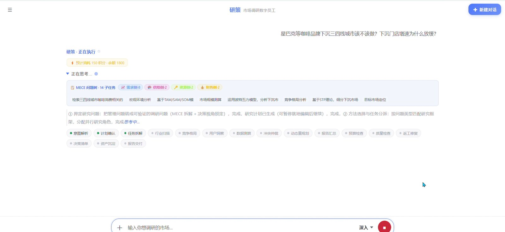
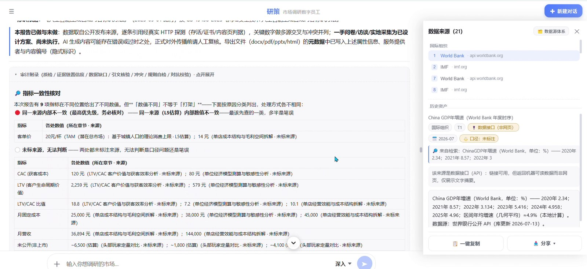
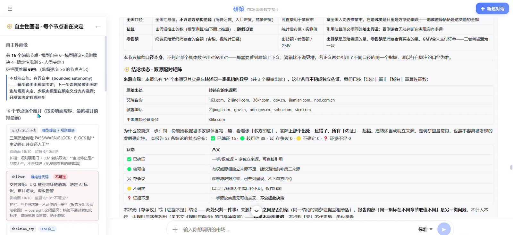
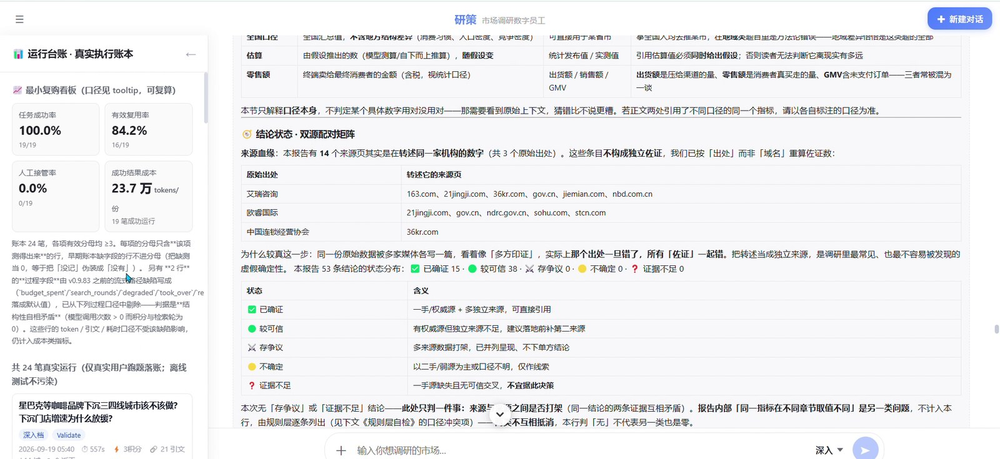
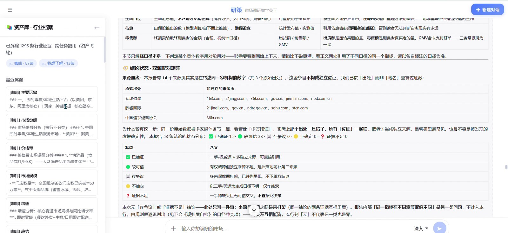

# 界面

> 前端的目标不是"好看"，是让审计这件事**在一屏之内可见**：结论、证据、代价、缺口同时在场。

## 1. 一屏四区

```
┌──────────────────────────────────────────────────────────────┐
│ chat-header    问题 · 档位 · 积分余额 · 运行状态              │
├───────────────────────────────────┬──────────────────────────┤
│                                   │                          │
│ chat-main                         │ cite-panel               │
│ 计划 / 执行轨迹 / 报告正文        │ 证据卡 · 来源 · 核验状态 │
│ 闸门横幅 · 决策链 · 附录          │ 默认 430px，可收起       │
│                                   │                          │
├───────────────────────────────────┴──────────────────────────┤
│ chat-inputbar   追问 · 改计划 · 重跑 · 导出                   │
└──────────────────────────────────────────────────────────────┘
```

设计取舍：

- **证据面板常驻**，不做成弹窗。弹窗意味着"你可以不看"，常驻意味着"它一直在那"。
- **判定先于正文**：报告卡第一屏是判定徽章与验证任务，正文在后。
- **审计附录默认折叠、可展开**：不干扰阅读，但不能被藏起来。

## 2. 八个互斥抽屉

| 抽屉 | 回答的问题 |
|---|---|
| 历史对话 | 我之前问过什么 |
| 设置 | 档位、积分、补充积分 |
| 资产库 · 行业档案 | 系统攒下了什么可复用的证据 |
| 运行台账 · 执行账本 | 这次/历次运行花了多少、成了多少 |
| 自主性图谱 | 每个节点是模型在决定、规则在决定，还是人在决定 |
| 工具合同 | 每个工具的目的 / 输入 / 输出 / 权限 / 失败处理 / 审计落点 |
| 记忆 | 它记住了我什么（本机文件，不含账号数据） |
| 决策回访 | 当初的判断，今天还站得住吗 |

抽屉互斥：同时只开一个，避免"面板叠面板"把屏幕塞满。

## 3. 界面实拍

以下 8 张为 2026-09-19 的真实运行截图，未经修图。文件按拍摄顺序命名。

| | |
|---|---|
|  |  |
|  |  |
|  |  |
|  |  |

## 4. 已知技术债

- `App.jsx` 为单文件实现（4,882 行），未拆组件；
- 部分样式写在 `App.css`（3,832 行），未做设计 token；
- 未做点击级自动化测试，界面回归靠人工截图。

前端组件化排在 [ROADMAP](ROADMAP.md) 的 P1 第一位。当前形态是"能跑、能演示、能改"，不是"能多人协作维护"。
